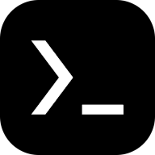

# Cli

<p align="center"></p>

**A pocket Linux terminal for Android, tuned for cloud / DevOps work.**
Open the app and you are inside a tiny Alpine Linux with Claude Code, AWS CLI, kubectl, helm, git, ssh/mosh and tmux already installed, ready to link to your Mac.

Cli is a fork of [Termux](https://github.com/termux/termux-app) (GPLv3) with a different first-run experience. Nothing is rooted, nothing is emulated beyond `proot`.

## Why

- One lightweight Linux (Alpine, about 3 MB base) instead of a heap of packages or multiple distros.
- Claude Code installed **natively** (musl build), with an npm fallback.
- Opens straight into a persistent `tmux` session, so a dropped connection or a locked screen doesn't lose your work.
- Termux's default look and extra-keys row, with a Menlo-style monospace font (DejaVu Sans Mono).

## What you get inside

| Area | Tools |
|---|---|
| AI | `claude` (Claude Code, native) |
| Cloud | `aws` (aws-cli v2), `kubectl`, `helm`, `gh`, `docker` + `docker compose` (client only) |
| Access | `ssh`, `mosh`, `rsync`, `mac-init`, `pull-creds` |
| Dev | `git`, `node` + `npm`, `python3` + `pip`, `psql`, `nvim`, `ripgrep`, `fd`, `fzf`, `jq`, `yq`, `htop` |
| On demand (`cli-add <tool>`) | `bun`, `vercel`, `supabase`, `eksctl`, `k9s`, `redis`, `terraform` |

Handy aliases: `c` (claude), `cc` (claude --continue), `k` (kubectl), `dc` (docker compose), `g` (git).

## Install

1. Download `Cli.apk` from the [Releases](../../releases) page.
2. Allow installing from unknown sources. On Samsung phones, turn off **Auto Blocker** first (Settings → Security and privacy → Auto Blocker).
3. Open **Cli**, connect to the internet, and follow the prompts. First run downloads Alpine and installs the tools (a few minutes).

Requirements: Android 7+ on a 64-bit ARM phone (`arm64-v8a`). Tested target: Samsung Galaxy F14 5G, Android 15.

## First steps

```sh
claude              # sign in with the link it prints
mac-init            # link your Mac: ssh key + `ssh mac` + docker context
pull-creds          # (optional) copy ~/.aws, ~/.kube and ssh config from the Mac
aws sts get-caller-identity
kubectl config get-contexts
```

### Connecting to your Mac

1. On the Mac: System Settings → General → Sharing → **Remote Login** on.
2. Install **Tailscale** on the Mac and the phone so the Mac is reachable from anywhere (no port forwarding).
3. In Cli run `mac-init`, then use `ssh mac` or `mosh mac`.
4. Run heavy things (Docker, builds, the real project checkouts) on the Mac and use the phone as the terminal: `docker --context mac ps`.

## Storage and the SD card

At first run Cli looks for an SD card and uses it automatically.

- **SD card that Android lets programs run from (adoptable ext4/f2fs):** the whole Linux system is installed on the card.
- **Normal FAT/exFAT SD card (all Samsung phones):** Android mounts it with no symlinks and no executables, so Linux itself can't run from it. The system (about 1.2 GB) stays internal, and **everything you create goes to the SD card**: `/root/work`, `~/.cache`, `~/.npm`, pip and apk caches.

Keep `npm install`-style projects (they need symlinks) outside `/root/work`, or work on the Mac over ssh. The Termux base (about 80 MB) and the APK always stay internal.

## Commands on the host side

```sh
cli doctor    # storage, arch, which tools are present, Android tips
cli setup     # (re)run the setup
cli enter     # enter Alpine manually
cli host      # stay in the bare host shell on startup (undo: rm ~/.cli-no-auto)
cli reset     # delete the Alpine environment
```

## Keeping sessions alive (Android 12+ / Samsung One UI)

- Settings → Battery → Cli → **Unrestricted**.
- Developer options → **Disable child process restrictions** (Android 14+ has this toggle built in; it stops Android killing background shells).
- Keep the Cli notification, and use tmux (already automatic).

## Known limitations

- `wrangler`/`workerd` don't run on Alpine (they need glibc). Use them on the Mac.
- Docker is client-only. There is no daemon on a phone.
- Claude Code's native installer on Alpine under `proot` is best-effort; if it fails the setup falls back to `npm`, or run `cli-add claude`.
- `proot` adds some overhead compared to a native shell.
- The APK is signed with the public Termux debug test key. That is fine for personal use, not for publishing to a store.

## Build from source

Needs JDK 17, the Android SDK (platform 36, build-tools 35.0.0 and 36.0.0) and NDK 29.0.14206865.

```sh
echo "sdk.dir=$ANDROID_HOME" > local.properties
./gradlew assembleDebug
# app/build/outputs/apk/debug/termux-app_apt-android-7-debug_universal.apk
```

The build runs `tools/make-bootstrap.py` (needs `python3` and `curl`) to create `app/src/main/cpp/bootstrap-aarch64.zip`. After changing it, delete `app/build` and `app/.cxx` so the native library is rebuilt.

Where the changes live:

- `app/src/main/assets/cli/`: launcher (`bin/cli`), login hook (`profile.d/cli-boot.sh`), the Alpine setup and helper scripts (`alpine/`), and the Termux theme/properties.
- `app/src/main/java/com/termux/app/TermuxInstaller.java`: copies those assets into place and lists SD card paths.
- `app/build.gradle`: arm64-only build, package id `app.clipod`, builds the patched bootstrap.
- `TermuxConstants.java` + `strings.xml`: app name and package id.

The package id is `app.clipod`. `tools/make-bootstrap.py` builds the bootstrap at build time: the upstream Termux bootstrap plus proot, with the hardcoded app path rewritten to `/data/data/app.clipod` (same length, so binaries stay valid). Don't use `pkg`/`apt` on the host; everything you need lives in Alpine (`apk add`).

## License

GPLv3, inherited from Termux. See [LICENSE.md](LICENSE.md). Termux is a project of the Termux developers; Cli is not affiliated with it.
